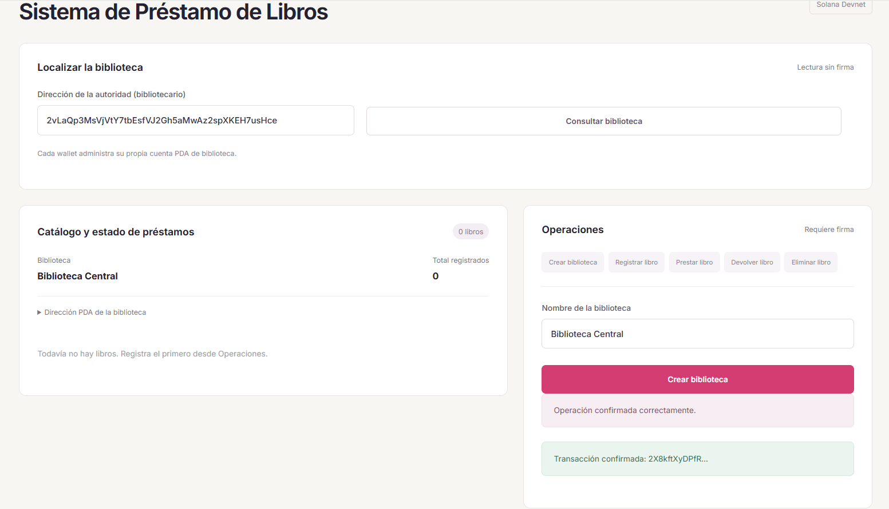

# Sistema de Préstamo de Libros en Solana (Devnet)

Aplicación descentralizada (dApp) construida con **Anchor (Rust)** y **React + TypeScript + Solana Kit** que permite administrar el catálogo y los préstamos de una biblioteca en Solana Devnet mediante cuentas derivadas por programa (PDAs).

## Información del Despliegue
- **Red:** Solana Devnet
- **Program ID:** `DaowjZYrHSizT8mEeXpKTwvtSkjapPfkKDxdeZ63D7vN`
- **Autoridad (Wallet desplegadora):** `2vLaQp3MsVjVtY7tbEsfVJ2Gh5aMwAz2spXKEH7usHce`
- **Explorer:** [Ver programa en Solana Explorer](https://solana.com)

## Arquitectura de Cuentas (PDAs)
1. **`Biblioteca`**: Derivada con las semillas `["biblioteca", autoridad]`. Almacena la clave pública de la autoridad, el nombre de la biblioteca y el contador total de libros (`total_libros`).
2. **`Libro`**: Derivada con las semillas `["libro", biblioteca, codigo_isbn]`. Almacena el ISBN, título, estado de préstamo (`prestado: bool`) y la wallet del usuario prestatario (`prestatario`).

## Instrucciones del Contrato Inteligente
- `inicializar_biblioteca`: Crea la cuenta PDA de la biblioteca vinculada a la wallet conectada.
- `registrar_libro`: Crea una cuenta PDA independiente por cada libro (usando su ISBN) e incrementa el contador total.
- `prestar_libro`: Valida que el libro esté disponible (`!libro.prestado`) y registra la wallet del prestatario.
- `devolver_libro`: Valida que el libro esté prestado (`libro.prestado`) y lo libera nuevamente.
- `eliminar_libro`: Cierra la cuenta PDA del libro (únicamente si no está prestado) y devuelve la renta (`lamports`) a la autoridad.

## Cómo ejecutar el frontend localmente
1. Instalar dependencias:
   ```bash
   npm install
   ```
2. Generar el cliente TypeScript desde el IDL:
   ```bash
   npm run cliente
   ```
3. Iniciar el servidor de desarrollo:
   ```bash
   npx vite
   ```

   ## Evidencias de Funcionamiento en Devnet

### 1. Biblioteca Inicializada


### 2. Libro Registrado (Disponible)


### 3. Préstamo de Libro (Prestado)

